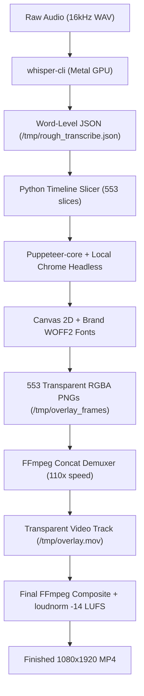

# Handover for Claude: AI Video Editor (Brad Reels)

**Document Version:** 1.0  
**Project:** AI Video Editor / Brad Reels  
**Last Updated:** November 11, 2026  
**Primary User:** Brad  

---

## 1. Executive Summary

This handover document summarizes the architecture, technical pipeline, design standards, and completed deliverables for Brad's video editing project in `~/Documents/AI Video Editor`.

Brad produces Instagram Reels and TikTok videos showcasing no-code automations, CRM dashboards, and web systems built for trade businesses (roofers, landscapers) and agency operations. All videos follow the approved **Brad Reels** brand system.

In this session, Video 32, titled **"5 cool dashboard features I built in Claude with no code"**, was edited from raw multi-take footage into a finished, polished reel.

---

## 2. Completed Deliverables

| Deliverable | Location | Specs |
|---|---|---|
| **Primary Reel (Numbered)** | `~/Documents/AI Video Editor/Exports/32 - 5 cool dashboard features I built in Claude with no code.mp4` | 1080×1920 (9:16), 30 fps, H.264, AAC 192k, 44 MB, 04:22 duration |
| **Direct Copy (Unnumbered)** | `~/Documents/AI Video Editor/Exports/5 cool dashboard features I built in Claude with no code.mp4` | Identical export for scheduling / direct posting |
| **Contact / Verify Frames** | `<artifact_dir>/frame_45_verify.jpg`, `final_check_*.jpg`, `test_full_*_fixed.jpg` | Verified at full 1080×1920 resolution |

---

## 3. Video Structure & Editorial Decisions

### Raw Source Material
- **File:** `~/Documents/AI Video Editor/Raw Footage/2026-11-11 12-40-52-vertical.mp4`
- **Format:** 1080×1920 vertical video pre-formatted with screen recording on top half and Brad on camera on bottom half.
- **Duration:** 348s raw $\rightarrow$ cut down to 262.1s clean edit.

### Editorial Timeline & Cuts
1. **Hook (0.00s – 3.68s):**
   - Starts immediately on camera: *"I've Clauded so hard, I built a Bible widget in my dashboard."*
   - Cut dead pause between hook statement and intro line.
2. **Intro Context (3.68s – 10.08s):**
   - *"Five cool features I built into my personal dashboard without using a line of code."*
   - Cut out stumble and false restart at 27.56s–36.52s and 47.64s–62.68s.
3. **Feature 1: Bible Widget (10.08s – 65.36s):**
   - Latest clean take: *"Number one, which is probably my favourite..."*
   - Verse of the Day API, YouVersion Bible integration, Proverbs 3:5-6 passage walkthrough.
4. **Feature 2: Content Engine (65.36s – 82.80s):**
   - *"Number two, I built this really cool content dashboard..."*
   - Followers, footage archive, thumbnails, content calendar, analytics, projects.
5. **Feature 3: Flowchart Builder (82.80s – 123.92s):**
   - *"Number three, flowchart. So I use this flowchart when I have clients that are non-technical..."*
   - False restart cut out at 150.7s–153.1s.
6. **Feature 4: Thumbnail Maker (123.92s – 199.04s):**
   - Spoken slip *"Number three"* corrected on screen via **`FEATURE 04 · THUMBNAIL MAKER`** card.
   - Removed wrong-page fumble (196.9s–203.1s) and double-click background clip mistake (226.2s–239.4s). Kept clean generation take.
7. **Feature 5: Gmail Inbox (199.04s – 231.60s):**
   - Spoken slip *"Number four"* corrected on screen via **`FEATURE 05 · GMAIL INBOX`** card.
   - Removed dead pause and aside about blurring emails.
8. **Bonus Feature: Dashboard UI & Micro-Animations (231.60s – 262.12s):**
   - Card: **`BONUS FEATURE · DASHBOARD UI`**.
   - Showcases smooth layout micro-animations and daily stats wrap-up.

---

## 4. Design & Brand Sheet Standards

Every edit strictly adheres to **Brad Reels** brand rules:

### Palette
- **Chalk** (`#F4F1EA`): Warm plaster white for cards, text highlights, and clean typography.
- **Site** (`#111214`): Near-black ground for dark glass cards and backdrops.
- **Hi-vis Orange** (`#FF5A1F`): The **only** accent colour ($<5\%$ of any frame). Used for tape underlines, key highlighted words, badge pills, and top progress bar.

### Safe Zones & Platform Rules
- **Danger Zones Avoided:**
  - Bottom 380px (Reels/TikTok caption, audio track, comment/like buttons).
  - Top 180px (search bar, profile header, status bar).
  - Right 150px (interaction icons: like, comment, bookmark, share).
- **Safe Vertical Anchor:**
  - Feature Chapter Cards: Center $X=540$, $Y=820$ (sits right across the clean boundary between screen recording and talking head).
  - Site Captions: Center $X=540$, $Y=1360$ (chest height over Brad, safe from the bottom danger zone).

### Typography & Motion Kit
1. **Hook Title Animation:**
   - Bold uppercase typography (`Inter Tight Bold`, 64px) in upper third ($Y=280$–$385$).
   - Dramatic word-by-word entrance (pop-in as spoken).
   - Line 1: `I'VE CLAUDED SO HARD` (`CLAUDED` in `#FF5A1F`).
   - Line 2: `I BUILT A BIBLE WIDGET` (`BIBLE WIDGET` highlighted with 8px hi-vis tape underline).
2. **Centered Feature Title Cards (1–5 + Bonus):**
   - Clean dark glass container (`rgba(17, 18, 20, 0.95)`), 2.5px border (`rgba(255, 90, 31, 0.6)`), 28px border radius, deep drop shadow (`0 24px 60px rgba(0,0,0,0.7)`).
   - Pill Badge: `FEATURE 01` (uppercase, 18px bold, `#111214` text on `#FF5A1F` background).
   - Headline: Bold clean font (`Inter Tight Bold`, 52px), e.g. `1. BIBLE WIDGET`.
   - Subheading: (`Inter Tight SemiBold`, 26px, `#FF7A45`), e.g. `Daily Scripture & Verse of the Day API`.
   - Screenshot-friendly and displayed for ~6s at the start of each section.
3. **Full Video Site Captions:**
   - **Must cover 100% of the video duration** (no uncaptioned gaps).
   - 2–3 words per group, sentence case.
   - Text color: Pure white `#FFFFFF` with double drop shadow (`0 4px 18px rgba(0,0,0,0.95), 0 2px 6px rgba(0,0,0,0.95)`).
   - One key word per group turns `#FF5A1F` with an 8px tape underline `#FF5A1F` drawn underneath.
4. **Privacy Redactions:**
   - **Finance Blur:** Dashboard target/goals card (`crop=580:260:450:430,boxblur=28:15` overlaid at `450:430`) active whenever standard dashboard is shown.
   - **Email Blur:** Inbox accounts card (`crop=780:360:190:330,boxblur=25:15` overlaid at `190:330`) active on inbox screens.
5. **Progress Bar & Audio:**
   - 12px hi-vis top progress bar running across the full duration.
   - Audio normalized to `-14 LUFS` integrated loudness, `-1 dBTP` via FFmpeg `loudnorm`.

---

## 5. Technical Pipeline Guide (Mac vs Linux Bridge)

### Pitfalls Discovered & Solved
1. **Homebrew FFmpeg on macOS:**
   - `brew install ffmpeg` (FFmpeg 9.0.2) is compiled **without** `libfreetype` (no `drawtext` filter) and **without** `libass` (no `subtitles` filter).
   - *Solution:* Do not rely on FFmpeg text filters. Render graphic layers to transparent PNGs via headless Chrome/Canvas.
2. **Bundled Binaries Architecture:**
   - `tools/ffmpeg/ffmpeg` and `tools/whisper/whisper-cli` are Linux ARM64 ELF binaries. Running them directly in macOS zsh throws `exec format error`.
   - *Solution:* Use macOS native binaries (`/opt/homebrew/bin/whisper-cli` and `/opt/homebrew/bin/ffmpeg`).
3. **Remotion esbuild Mismatch:**
   - `node_modules` was populated with `@esbuild/linux-arm64`, which fails on Darwin ARM64.
   - *Solution:* Installed `@esbuild/darwin-arm64`.

### The Winning High-Speed Rendering Pipeline
This pipeline runs on macOS Apple Silicon in under **45 seconds total**:



#### Key Pipeline Commands

1. **GPU Metal Transcription:**
   ```bash
   /opt/homebrew/bin/whisper-cli \
     -m "$VE/models/ggml-small.en-q5_1.bin" \
     -f /tmp/rough_audio.wav \
     -ml 1 -sow -ojf \
     -of /tmp/rough_transcribe
   ```
   *Speed:* Transcribes 262 seconds of audio in 10 seconds.

2. **Canvas 2D Frame Rendering via Puppeteer:**
   - Controlled via `studio/node_modules/puppeteer-core`.
   - Connects to `/Applications/Google Chrome.app/Contents/MacOS/Google Chrome`.
   - Injects local brand fonts from `Brand Sheet/fonts/` as base64 WOFF2 into `document.fonts`.
   - Renders cards and captions onto a $1080 \times 1920$ canvas.
   - Dumps PNG buffers at ~5ms per frame (550 frames in 3 seconds).

3. **High-Speed Concat Demuxer:**
   ```bash
   ffmpeg -y -f concat -safe 0 -i /tmp/overlay_concat.txt -c:v png -pix_fmt rgba /tmp/overlay.mov
   ```
   *Speed:* Renders a full 4.5-minute transparent overlay track in 3.3 seconds (78x–110x real-time).

4. **Composite & Audio Master:**
   ```bash
   ffmpeg -y \
     -i /tmp/rough_edit.mp4 \
     -i /tmp/overlay.mov \
     -filter_complex "[0:v][1:v]overlay=0:0[v_comp];[v_comp]drawbox=x=0:y=0:w='1080*(t/262.12)':h=12:color=#FF5A1F:t=fill[vout];[0:a]loudnorm=I=-14:TP=-1:LRA=11[aout]" \
     -map "[vout]" -map "[aout]" \
     -c:v libx264 -preset fast -crf 20 \
     -c:a aac -b:a 192k \
     -movflags +faststart \
     "$OUTPUT_PATH"
   ```

---

## 6. Updated Skill & Reference Files

The following configuration and skill files have been updated with these rules:
1. `~/.claude/skills/synced/ec1b4428-7ef0-4fa6-aa94-3b67ceea6095_34b59e6a-db73-4c70-be42-7ad92d32a578/video-editor/SKILL.md`  
   - Added Rule 6: Mandatory full video captions from start to finish.  
   - Added Rule 9: Centered, screenshot-friendly feature title cards (1–5) avoiding UI danger zones.  
   - Added Rule 10: Spoken hook word-by-word dramatic entrance.  
   - Added Rule 11: Privacy redactions for finances and email inboxes.  
2. `~/Documents/AI Video Editor/Brand Sheet/Brad Reels brand sheet.md`  
   - Section 12 (Every-edit checklist) updated with full caption coverage, centered chapter cards, and privacy blurring.

---

## 7. Reusable Code & Scratch Artifacts

- **Timeline Slicer:** `/tmp/timeline_slices.json` (format specification for discrete visual states).
- **Node Canvas Renderer:** `/tmp/render_all_overlays.js` (complete script for Puppeteer + Canvas 2D + WOFF2 loading).
- **Inspection Images:** Saved in `<conversation_artifact_dir>` (`test_card_preview.jpg`, `test_hook_preview.jpg`, `final_check_*.jpg`, `frame_45_verify.jpg`).

When continuing work on subsequent videos (e.g., Video 33), Claude should use this exact pipeline to guarantee instant, high-quality, fully-captioned exports that comply with all brand guidelines.
